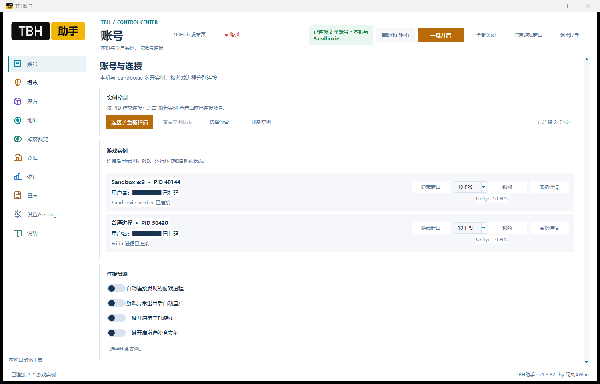
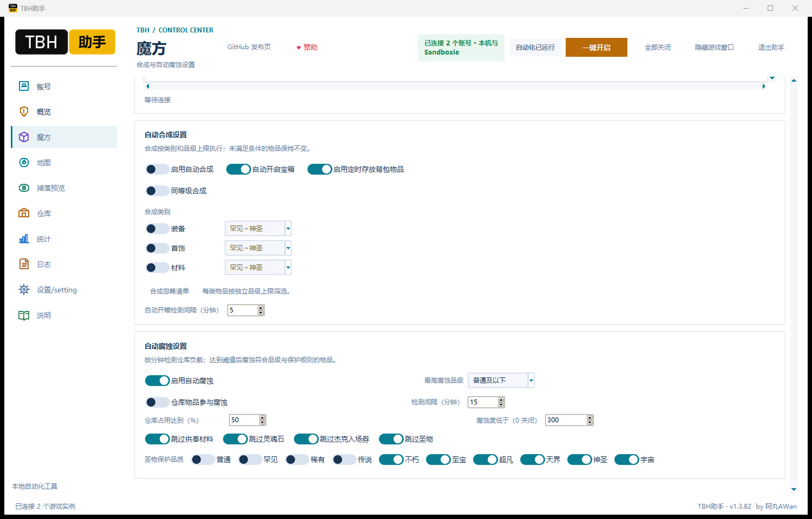
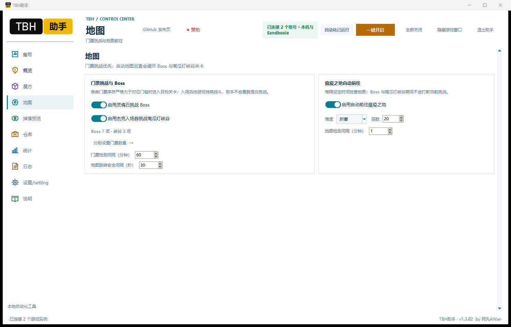
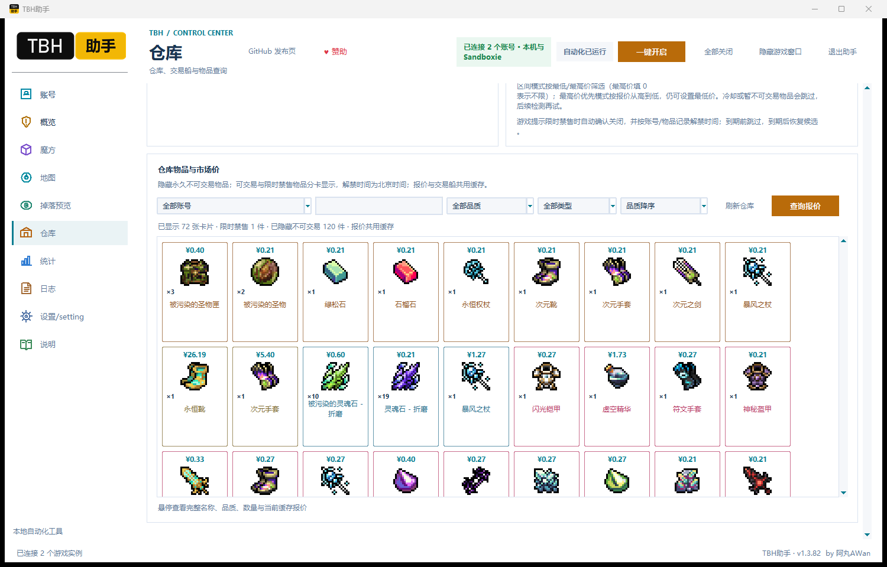
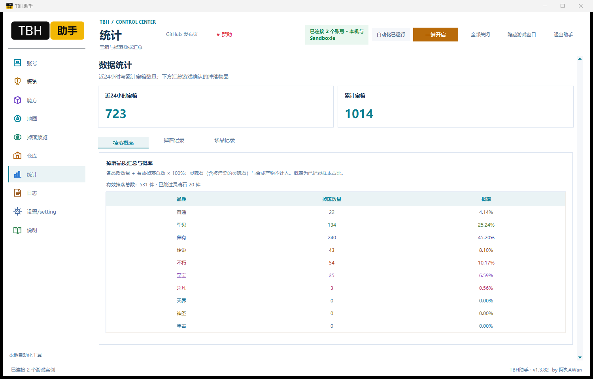
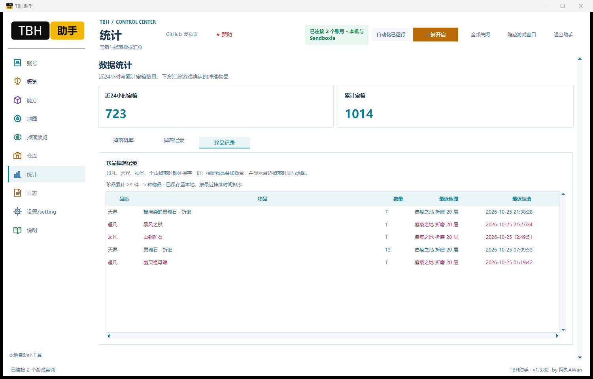

# TBH助手

TaskBarHero Windows 托管助手，维护署名 **by 阿丸AWan**。当前发布版 **v1.3.82** 使用 Frida 连接正在运行的游戏进程，支持本机与 Sandboxie 多开实例，无需向游戏目录部署插件。

**[下载 v1.3.82 Windows x64 ZIP](https://github.com/buguniaoOVO/TBHHelper/releases/download/v1.3.82/TBHHelper-v1.3.82-win-x64.zip)** · [更新公告](https://github.com/buguniaoOVO/TBHHelper/releases/tag/v1.3.82) · [使用说明](docs/QUICKSTART.md) · [介绍帖](docs/forum-post.md) · [问题反馈](https://github.com/buguniaoOVO/TBHHelper/issues)

## 本次响应修复

v1.3.82 修复上一版本统计标签页背景平铺导致的大量重绘。窗口拖动保持固定 DPI 字体，按窗口宽度调整工具栏；导航页只布局当前页面。统计刷新增加缓存并合并连续掉落事件。

恢复游戏窗口改为异步投递，每个账号独立确认；超时后保留重试入口，其他账号继续处理。掉落记录删除概率列，品质概率汇总保留。游戏本体卡死尚未复现，此版本修复已确认的助手重绘与跨进程窗口等待问题。

## 直连版功能

- 重写连接逻辑，直接连接游戏进程，按账号管理本机与 Sandboxie 实例。
- 增加各账号独立锁帧、隐藏与显示窗口；锁帧用于降低后台渲染开销，实际占用随机器与场景变化。
- 增加自动转入游戏内交易船和手动执行一轮；按价格区间或最高价优先选品，记录限时禁售期限并在解禁前跳过。
- 增加 Boss 与南瓜灯峡谷门票检测，按检测周期与门票数量设置挑战；地图跳转设有安全间隔。
- 定时开箱、定时全背包存仓；腐蚀按账号独立检查污染度与仓库占用，支持品类保护。
- 仓库图标卡片、数量合并、缓存报价与禁售期限展示。
- 统计页使用“掉落概率 / 掉落记录 / 珍品记录”三个标签页。品质概率排除灵魂石；超凡、天界、神圣、宇宙额外保存珍品记录。

## 功能页面

| 页面 | 内容 |
| --- | --- |
| 账号 | 进程与用户名、本机和沙盒连接、各账号隐藏窗口与锁帧 |
| 概览 | 连接状态、自动化状态、常用入口 |
| 魔方 | 装备与材料合成、定时开箱、按账号检查并执行腐蚀 |
| 地图 | 瘟疫之地难度与层数、门票与 Boss、南瓜灯峡谷、地图安全间隔 |
| 仓库 | 自动存仓、自动交易船、图片卡片、报价与禁售时间 |
| 统计 | 近24小时和累计宝箱、品质概率、掉落明细、珍品记录 |
| 设置 | 连接策略、配置管理、启动及每12小时检测更新，可关闭自动检测 |
| 掉落预览 | 暂不可用 |

### 腐蚀和定时任务

后台任务按各自设置的检测周期运行。开箱按宝箱品种批量开启，一种完成后再处理下一种；自动存仓按设定分钟数将背包物品存入仓库，实际结果受仓库空间与游戏规则限制。向游戏提交的开箱、合成、腐蚀等操作使用安全间隔。

腐蚀条件逐个账号判断：达到设置的仓库占用比例，或污染度低于设置值时，由该账号执行腐蚀。可保护灵魂石、供奉材料、杰克入场券以及指定品质的圣物。请在运行前检查保护选项。

### 地图和门票

瘟疫之地可设置难度、1至20层和检测间隔；Boss 关及南瓜灯峡谷运行期间按地图规则避让。门票检测读取当前地图与库存，满足条件后进入对应关卡。Boss 入场后由游戏持续战斗消耗门票。

### 仓库和交易船

仓库按物品显示图标、数量、品质及缓存报价；永久不可交易物品从仓库展示中隐藏。交易限时禁售的商品显示解禁时间，并在到期前跳过。报价支持手动查询与约一小时后台刷新；刷新失败时保留上次成功缓存。

交易船提供价格区间、最高价优先、检测间隔和“立即转入一轮”。每轮检查四个槽位，完成放入及确认上传流程。此功能作用于**游戏内交易船**，不执行 Steam 市场一键出售。市场报价仅供参考，网络、限流和数据源更新会影响查询结果。

### 掉落统计

品质概率按“各品质有效掉落数量 ÷ 有效掉落总数 × 100%”计算。灵魂石与被污染的灵魂石保留在掉落记录中，详情表仅显示品质、物品、数量、最近地图与最近掉落时间；装备、首饰及材料合成产物不计入掉落统计。概率是已记录样本占比，不能视作官方掉率。

珍品记录额外保存超凡、天界、神圣、宇宙品质掉落。相同物品叠加数量，展示最近掉落时间与地图。珍品记录保存在本地独立文件，可在助手重启后恢复。

## 安装与更新

1. 下载 Windows x64 ZIP，完整解压到可写文件夹。
2. 从 Steam 启动游戏，再运行 `TBH助手.exe`，在账号页连接或重新扫描。
3. 检查对应账号及各项规则，再点击“一键开启”。可使用“全部关闭”停止助手自动化。
4. 旧版用户先退出助手，再覆盖程序文件；保留自己的配置、历史与缓存文件。请备份旧目录。

v1.3.82 无需部署 BepInEx、Java 或观星插件。旧版曾安装的游戏插件不由本次压缩包自动清理；旧插件仍运行时应先停用旧助手，避免重复操作。

## 数据与范围

配置与历史位于助手目录，包括 `auto_synthesis_config.json`、`auto_synthesis_history.jsonl`、`auto_synthesis_rare_drops.jsonl` 以及 `cache`。发布包不包含个人配置、账号缓存和运行日志。截图中的用户名已打码。

Windows 10/11 x64；游戏更新可能改变进程接口。请遵守游戏和平台规则，自动化存在账号与物品操作风险。遇到异常先点“全部关闭”，反馈助手版本、游戏版本、复现步骤和脱敏日志。掉落预览当前暂不可用。

## 源码与构建范围

本次直连版维护脚本位于 `maintenance/direct-connect`，属于针对既有 Python 3.14 打包程序的维护补丁。仓库原有 `src/java`、`src/plugin` 与根目录 `build.ps1` 保留为历史插件版代码，不能用来构建 v1.3.82。详见 [构建说明](docs/BUILD.md)。

既有代码和第三方组件保留各自权利与许可，参见 [LICENSE](LICENSE) 和 [NOTICE](NOTICE.md)。

[GitHub 发布页](https://github.com/buguniaoOVO/TBHHelper/releases/latest) · [自愿赞助](https://afdian.com/a/Awan0v0)

by 阿丸AWan
